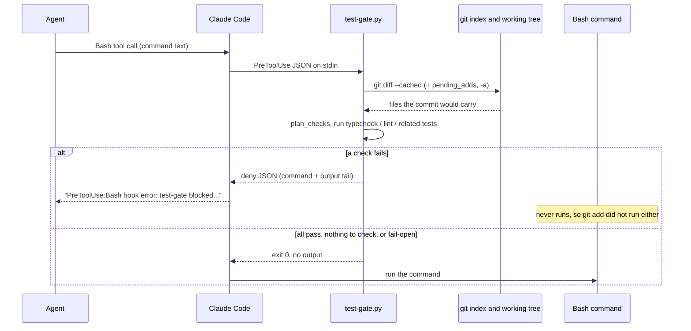

# Test gate: the first real deny

The test gate is a PreToolUse(Bash) hook that checks a `git commit` before it runs. Until 2026-10-12 its log held only `allow` decisions. That day the agent tried to commit a planted type error three times; two commits slipped through and the third was denied. This doc records what the gate does, why the first two attempts passed, and what it still cannot see.

## What the gate is

- Registered in `.claude/settings.json:12-22` as `PreToolUse`, matcher `Bash`, command `.claude/hooks/test-gate.py`, timeout 600 s.
- A command with no `git commit` in command position exits 0 with no output, no git call and no log (`.claude/hooks/test-gate.py:317-318`).
- For a commit it collects the files the commit carries (`test-gate.py:333-348`), picks checks per package (`plan_checks`, `test-gate.py:248-301`) and runs them in order. For `server/` those are `pnpm -s typecheck`, `pnpm -s lint:boundaries` and `pnpm exec vitest related --run` on the changed files (`test-gate.py:273-278`).
- A failing check logs `deny` and prints the deny JSON with the failing command and the last 40 lines of output (`test-gate.py:383-392`, `TAIL_LINES` at `test-gate.py:65`). A timeout is also a deny (`test-gate.py:375-381`).
- Log: `~/.claude/state/test-gate/log.jsonl` (`test-gate.py:60-63`). Decisions written: `allow`, `deny`, `override`, `fail-open`.
- The full decision table is the module docstring, `test-gate.py:9-21`.

## Timing

PreToolUse fires before the Bash command starts. Whatever the command itself does (an edit, a `git add`) has not happened when the hook looks.



## The three attempts (2026-10-12)

A Claude Code session started from this worktree, Opus 5.5 as the agent. The planted line was `export const passThreshold: number = "0.8";` at the end of `server/src/modules/eval/scoring.ts`.

| # | Command shape | Result | Why |
|---|---|---|---|
| 1 | one command: `printf … >> scoring.ts && git add scoring.ts && git commit -m …` | commit landed (`a268d8d`, local, reset with `git reset --soft HEAD~1`); no log line | At hook time the index was empty, so the "nothing staged" path returned silently (`test-gate.py:347-348`). Piping the same command JSON into the hook gave exit 0, no output, no log. A dry-run with `TEST_GATE_OVERRIDE=1` logged `override`, so the hook was loaded. |
| 2 | after the fix below, but the command still contained the `printf >>` edit | commit landed (`63279a0`, local, reset) | `scoring.ts` was still clean when the hook ran. |
| 3 | edit as a separate step, then `git add server/src/modules/eval/scoring.ts && git commit -m "feat(eval): pass threshold constant"` | denied | First real deny. |

Log line of attempt 3:

```json
{"ts": "2026-10-12T07:32:45.069486+00:00", "decision": "deny", "check": "server typecheck", "exit": 2, "seconds": 3.7}
```

What Claude Code returned to the agent:

```
PreToolUse:Bash hook error: test-gate blocked this commit: `server typecheck` failed (exit 2).
Command: (cd server && pnpm -s typecheck)
src/modules/eval/scoring.ts(159,14): error TS2322: Type 'string' is not assignable to type 'number'.
Fix the failure and commit again. Only the user may bypass the gate (TEST_GATE_OVERRIDE=1).
```

The whole Bash command was blocked, so the `git add` did not run either; the file was restored. Without the fix below this attempt would also have passed, because nothing was staged at hook time.

## The fix: `pending_adds`

`pending_adds()` (`test-gate.py:201-239`) reads the `git add` segments that come before the `git commit` in the same command and treats their files as staged:

- it follows `cd <dir>` and `git -C <dir>` (`test-gate.py:216-226`);
- `-A`/`--all` means the whole tree including untracked files; `-u`/`--update` means the whole tree, tracked files only; otherwise the given pathspecs (`test-gate.py:227-238`);
- `main()` adds `git diff --name-only` for those specs, plus `git ls-files --others --exclude-standard` when untracked files count (`test-gate.py:341-346`).

Tests in `.claude/hooks/tests/test_test_gate.py`, written red first (two failed before the fix; `python3 -m unittest discover -s .claude/hooks/tests` ran 82 tests, all green, after it):

- `test_git_add_in_the_same_command_is_checked` (`:177`)
- `test_git_add_all_picks_up_untracked_files` (`:186`)
- `test_git_add_of_other_paths_does_not_widen_the_check` (`:192`)

## Known limits

- **Edits inside the same command as the commit are invisible.** The hook runs before the command, so a `printf >> file && git add && git commit` chain is checked against the file as it was before the edit (attempt 2). `pending_adds` only widens which files are counted, not their content.
- **`git commit <paths>` (pathspec mode) is not covered.** Only the index, `-a` and earlier `git add` segments are read (`test-gate.py:17`).
- **Fail-open.** If git is unusable or a package's `node_modules` is missing, the commit is allowed and logged as `fail-open` (`test-gate.py:328-336`, `test-gate.py:358-360`). A missing tool binary does the same (`test-gate.py:372-374`).
- **Bypass.** `TEST_GATE_OVERRIDE=1` in the command allows and logs `override` (`test-gate.py:324-326`, `OVERRIDE_RX` at `:70`). The deny message reserves it for the user.
- **Session scope.** A hook loads only in a session started from the worktree whose `.claude/settings.json` registers it.
