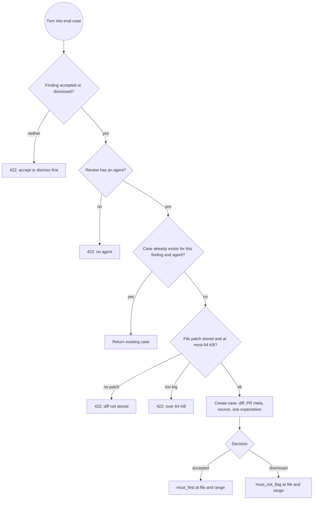
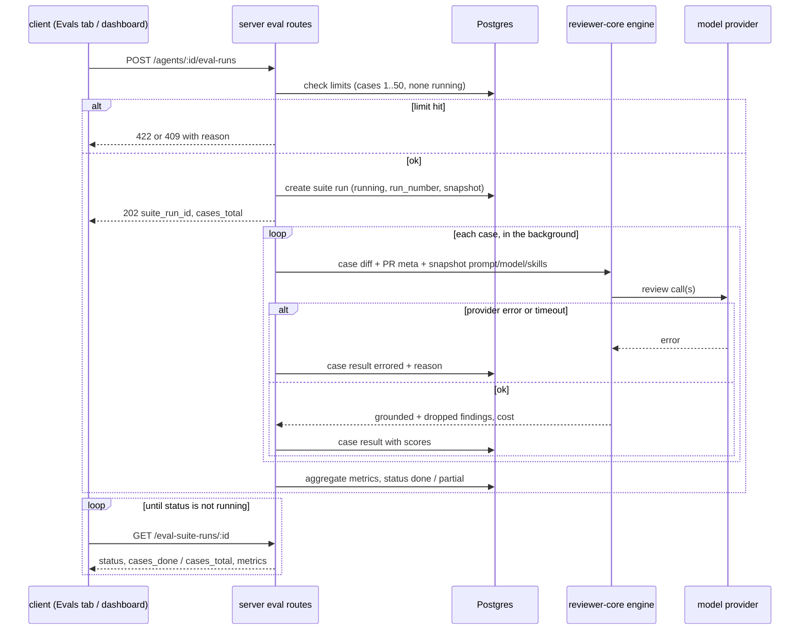

# Spec: Eval Pipeline: regression protection for review agents, built from accepted and dismissed findings
Spec ID: SPEC-2026-10-10-eval-pipeline
Status: approved (Glib, 2026-10-10)
Tier: Full SDD (scorecard 6/6)
Supersedes: none. Builds on ADR `../decisions/2026-10-10-eval-suite-runs-table.md` (accepted, Glib, 2026-10-10): a suite-run record per agent run with a configuration snapshot.
Packages: server, client. reviewer-core is not changed (see "Inputs and provenance").
Design sources:
- Assignment, L06 homework "Eval Pipeline for DevDigest" (translated, relayed 2026-10-10), plus the Case Editor and Trend charts extensions the user chose. The PreToolUse test-gate hook, mutation testing and skill-eval export are out of scope.
- Reference screenshots, six frames (to be copied to `specs/designs/eval-pipeline/`, see Handoffs):
  - img1: FindingCard actions with "Turn into eval case"
  - img2: Eval Dashboard, all agents
  - img3: per-agent dashboard
  - img4: compare modal
  - img5: AgentEditor Evals tab
  - img6: Case Editor modal
- Answers relayed 2026-10-10. Glib decided Q2 (precision and noise) and Q6 (scope). The main session decided Q0, Q1, Q3, Q4, Q5, Q7, N1 to N9 and the four UX proposals, following the spec-creator's recommendations. Glib then confirmed the Q0 limits himself and approved the spec ("так approved"). The last seven points were closed by main-session decisions he saw first; see Open questions.

## Problem and user

A reviewer changes an agent's system prompt, model or a linked skill, and today nothing says whether the agent got better or worse. The only signal is how future reviews feel. Since L01, users have accepted or dismissed findings: each accepted finding is a known true positive at a file and line range, and each dismissed finding is a known false positive. Those decisions sit in the database and are never reused.

The user is the person who tunes agents in the Skills Lab. They want three things:
- turn a real decision into a regression case in one click;
- write cases by hand for bugs the agent never saw;
- run an agent over its whole case set, read recall, precision and citation accuracy as numbers, and compare two runs ("old prompt vs new") side by side, with the prompt diff in view.

What exists today:
- `eval_cases` and `eval_runs` storage and the shared `EvalCase`, `EvalRun`, `EvalCaseInput`, `EvalRunRecord`, `EvalTrendPoint` and `EvalDashboard` contracts exist. No route, module or UI uses them.
- The `eval` i18n namespace exists but is not rendered anywhere.
- The sidebar has no Eval Dashboard item.
- Agents already carry a config version that bumps on any config change. A skill-body edit bumps only the skill's own version.

## Outcome and metrics

Outcome: the user edits a prompt, runs evals, and within one suite run sees whether recall, precision and citation accuracy moved, with the prompt diff that caused it. Deliberately breaking the prompt shows a precision drop and a regression banner.

Metrics, each verified by a test:
- 0 model calls in scoring. Scoring is deterministic: the same findings and expectations always give the same numbers (AC-17 to AC-23).
- 100% of suite runs end in `done`, `partial` or `failed`. None stays `running` after the run ends or the process restarts (AC-29, AC-30).
- Two suite runs of the same agent over the same case set, with the same configuration snapshot, differ only through model nondeterminism. No live input (project docs, memory, intent, callers) enters an eval prompt (AC-14).
- A suite run never exceeds 50 cases or 64 KB of diff per case (AC-8, AC-26).

## Options

Not applicable. The approach is fixed by the assignment, the ADR and the answers of 2026-10-10.

## Goals / Non-goals

Goals:
- One-click case creation from an accepted finding (must find) or a dismissed finding (must not flag).
- Manual case create, edit and delete in a Case Editor with a diff preview.
- A per-agent case list with each case's last result.
- Background suite runs over all of an agent's cases, plus "Run all agents".
- A single-case run from the editor or the case row, recorded as that case's last result only.
- Code-only scoring of recall, precision, citation accuracy and pass count.
- A run history, a trend chart and side-by-side compare with metric deltas, the case-set change and the system prompt diff.
- An Eval Dashboard page in the sidebar listing every agent's latest run, plus a per-agent dashboard with an agent switcher and a regression banner.

Non-goals:
- Promote: making a compared run's configuration the agent's active configuration.
- The Files tab in the Case Editor. No full-file inputs reach the prompt.
- A date-range filter (for example "30 days") on the dashboards.
- Cancelling a suite run.
- Repeating a case within one suite run to average out model nondeterminism.
- Skill-owned eval cases (`owner_kind = skill`). This spec covers agent-owned cases only.
- Running evals in CI, the test-gate hook, mutation testing, and exporting cases as skill evals.
- Changing the review engine, its grounding gate or its prompt assembly.
- Changing how live PR reviews run, are stored or are costed.

## User stories

- As an agent tuner, I turn an accepted finding into a "must find X at file:line" case in one click, so the agent is held to catching it again.
- As an agent tuner, I turn a dismissed finding into a "must NOT comment on Y" case, so a fixed false positive stays fixed.
- As an agent tuner, I paste a diff for a bug the agent never saw, set the expectation, file and line range, and preview the diff before saving.
- As an agent tuner, I run all of an agent's cases and read recall, precision and citation accuracy as numbers.
- As an agent tuner, I select two runs and see the metric deltas, the cost delta and the system prompt diff ("old prompt vs new").
- As an agent tuner, I open the Eval Dashboard and see every agent's latest run and trend, and a banner when the latest run regressed.

## Acceptance criteria (EARS)

### Case model

- AC-1 The system shall store every eval case with an ordered list of expectations. Each expectation has a type (`must_find` or `must_not_flag`), a file path and an inclusive line range, plus optional severity, category and title for display. An empty list means "expect clean": the agent must produce no grounded finding. — proof: red-first unit — verify: validate one expectation of each type and an empty list as accepted; a list item with no type, no file or start_line > end_line is rejected with a field error
- AC-2 The system shall scope every eval case, suite run and case result to the workspace of the agent that owns it. A request for another workspace's case, run or agent returns 404. — proof: red-first integration — verify: create a case in workspace A, request it, its runs and its agent's eval routes from workspace B, expect 404 on each

### Creating a case from a finding

- AC-3 WHEN the user activates "Turn into eval case" on an accepted finding, the system shall create a case in the set of the agent that produced the finding's review. The case has one `must_find` expectation with the finding's file, start and end lines, severity, category and title. — proof: red-first integration — verify: accept a finding produced by agent X, call the create-from-finding route, expect a case owned by X with one must_find expectation equal to the finding's file and range
- AC-4 WHEN the user activates "Turn into eval case" on a dismissed finding, the system shall create a case with one `must_not_flag` expectation carrying the finding's file and line range. — proof: red-first integration — verify: dismiss a finding, create the case, expect one must_not_flag expectation with the finding's file and range
- AC-5 WHEN a case is created from a finding, the system shall save the full patch of the finding's file from that PR as the case diff. It saves the PR title and body as the case PR meta, and the PR's repository and number as the case source. — proof: red-first integration — verify: seed a PR with two files and a finding on file B, create the case, expect the case diff to equal file B's whole patch only, and the PR meta title and body to equal the PR's
- AC-6 WHEN a case is created from a finding, the system shall name the case "<file>:<start_line> — <finding title>". — proof: red-first unit — verify: a finding titled "Hardcoded Stripe secret key in commit" at src/config.ts line 12 yields the name "src/config.ts:12 — Hardcoded Stripe secret key in commit"
- AC-7 IF the finding's file has no stored patch for that PR, THEN the system shall refuse to create the case with the message "This PR's diff is not stored yet. Open the PR once and try again." and create nothing. — proof: red-first integration — verify: seed a finding whose PR file has an empty patch, call create-from-finding, expect a 422 with that reason and no new case
- AC-8 IF the patch saved for a case, or a diff pasted into the Case Editor, exceeds 64 KB, THEN the system shall refuse to save the case and say that the diff is over the 64 KB limit. — proof: red-first integration — verify: create from a finding whose file patch is 65 KB and save a manual case with a 65 KB diff, expect 422 with the size reason in both and no case stored
- AC-9 WHILE a finding has neither an accepted nor a dismissed decision, the system shall show "Turn into eval case" disabled with the hint "Accept or dismiss first". The create route refuses such a finding with 422. — proof: e2e — verify: open a PR with an undecided finding, expect the button disabled with the hint; call the route directly, expect 422
- AC-10 IF the finding's review has no agent, THEN the system shall show "Turn into eval case" disabled and the route shall refuse it with 422. — proof: red-first integration — verify: seed a review with a null agent and a decided finding, expect 422 from the route
- AC-11 WHEN "Turn into eval case" is activated for a finding that already has a case in the same agent's set, the system shall return the existing case and create no second one. — proof: red-first integration — verify: call create-from-finding twice for the same finding, expect the same case id both times and one case in the set
- AC-12 WHEN a case is created from a finding, the client shall confirm it with a message naming the agent and a link to the case on that agent's Evals tab. IF creation fails, THEN it shall show the server's reason. — proof: e2e — verify: click the button on an accepted finding, expect a confirmation naming the agent with a working link; trigger the no-patch case, expect the reason text
- AC-13 WHEN a finding's decision changes after a case was created from it, the system shall keep the case's expectation unchanged. — proof: red-first integration — verify: accept a finding, create the case, dismiss the finding, read the case, expect its expectation still must_find

### Fixed inputs

- AC-14 WHEN a case is executed, the system shall give the review engine only the case diff, the case PR title and body, and the agent's system prompt, model, provider, strategy and linked skills, with skill bodies as of the moment of the run. It shall give no project-context docs, memory, PR intent, callers digest or repo map. — proof: red-first integration — verify: attach a project-context doc and enable intent on the agent, run a case with a capturing model double, expect the captured prompt to contain the diff and PR meta and none of the doc text, intent or callers sections
- AC-15 WHEN a case is executed, the system shall apply the review engine's existing grounding gate against the case diff, and keep both the grounded findings and the dropped findings in the case result. — proof: red-first integration — verify: a model double returns one finding inside a hunk and one outside, expect the case result to hold one grounded and one dropped finding

### Scoring (code only, no model)

- AC-16 The system shall count a grounded finding as matching an expectation when the file paths are equal and the finding's line range intersects the expectation's inclusive range. Severity, category and title are not compared. — proof: red-first unit — verify: expectation src/a.ts 10–12; findings src/a.ts 12–15 (match), src/a.ts 13–14 (no match), src/b.ts 10–12 (no match), and src/a.ts 11 with a different severity (match)
- AC-17 The system shall compute recall as the number of matched `must_find` expectations divided by the number of `must_find` expectations, pooled over every scored case in the suite run. With zero `must_find` expectations, recall is null. — proof: red-first unit — verify: three cases with 2, 1 and 0 must_find, where 2 of the 3 are matched, expect recall 0.667; a suite with no must_find expects null
- AC-18 The system shall treat as noise every grounded finding that matches a `must_not_flag` expectation of its case, and every grounded finding in an "expect clean" case. A finding that matches both a `must_find` and a `must_not_flag` expectation of the same case counts as noise and not as a match. — proof: red-first unit — verify: a case with a must_not_flag range and a finding inside it, and a clean case with one finding, expect both counted as noise; a finding outside every expectation in a must_find-only case is not noise; a finding inside overlapping must_find and must_not_flag ranges counts as noise, and that must_find stays unmatched unless another finding matches it
- AC-19 The system shall compute precision as matched findings ÷ (matched findings + noise findings), pooled over the suite run. Matched findings are the grounded findings that match a `must_find` expectation of their case. Every other grounded finding that is not noise is neutral and excluded, including a finding outside the `must_not_flag` range of a `must_not_flag` case. With zero matched and zero noise findings, precision is null. — proof: red-first unit — verify: 3 findings matching must_find, plus a must_not_flag case with one finding inside its range and one outside it, plus 2 neutral findings in must_find cases, give precision 3 ÷ (3 + 1) = 0.75 (the outside finding is neutral); a suite whose cases all produced zero findings gives null
- AC-20 The system shall compute citation accuracy as the number of grounded findings divided by grounded plus dropped findings, pooled over the suite run. With zero findings in total, it is null. — proof: red-first unit — verify: 9 kept and 1 dropped give 0.9; no findings at all give null
- AC-21 The system shall mark a case passed when every `must_find` expectation is matched and the case has no noise finding. Otherwise the case is failed. A `must_not_flag` or "expect clean" case with zero grounded findings passes. — proof: red-first unit — verify: a must_find case with the finding matched passes; with it missed, fails; a must_not_flag case with zero findings passes; a clean case with one grounded finding fails
- AC-22 IF a case's model call errors or times out, THEN the system shall record that case as errored with its reason and exclude it from recall, precision, citation accuracy and pass count. The suite run ends as `partial` instead of `done`. — proof: red-first integration — verify: a model double fails on case 2 of 3, expect case 2 errored with a reason, metrics computed from cases 1 and 3 only, suite status partial
- AC-23 The system shall show every null metric as "—", never as 0% or 100%, on the Evals tab, the dashboards, the compare view and chart tooltips. — proof: red-first unit — verify: render the metric cards and a history row with null precision, expect "—" in both
- AC-24 The system shall compute a suite run's cost as the sum of the known case costs, flagged partial when at least one executed case reported no cost. When no case reported a cost, the suite cost is null and shown as "—". — proof: red-first unit — verify: costs [0.01, null, 0.02] give 0.03 flagged partial; [null, null] give null

### Running a suite

- AC-25 WHEN the user starts a suite run for an agent, the system shall accept it with 202 and return the new suite run's id, status `running`, its per-agent run number and the number of cases. The cases execute in the background. — proof: red-first integration — verify: POST the agent's eval-runs route with 3 cases, expect 202 with suite_run_id, status running, run_number and cases_total 3 before any case completes
- AC-26 IF the agent has no cases or more than 50 cases, THEN the system shall refuse the suite run with 422 and a reason naming the limit. The Evals tab shows that reason. — proof: red-first integration — verify: an agent with 0 cases and one with 51 cases each get 422 with a reason; neither creates a suite run
- AC-27 IF a suite run for the same agent is already running, THEN the system shall refuse a new one with 409. — proof: red-first integration — verify: hold a running suite with a gated model double, start another for the same agent, expect 409; start one for another agent, expect 202
- AC-28 The system shall limit the suite-run, run-all and single-case-run routes to 10 requests per minute each. — proof: red-first integration — verify: send 11 requests in a minute to the suite-run route, expect the 11th to be rate-limited
- AC-29 WHILE a suite run is in progress, the system shall report cases done out of cases total on the suite-run read route, and the Evals tab and the per-agent dashboard shall poll it and show "Running k/N" until it ends. — proof: e2e — verify: start a suite on a seeded agent with a slow model double, expect "Running" with a k/N count that rises, then final metrics without a reload
- AC-30 IF a suite run fails as a whole (an unexpected error, or a process restart while it ran), THEN the system shall mark it `failed` with a reason. It never stays `running`. A suite still `running` at server start is marked `failed` with the reason "interrupted". — proof: red-first integration — verify: force an error after case 1, expect status failed with a reason; seed a running suite row, start the app, expect it read as failed with "interrupted"
- AC-31 WHEN a suite run starts, the system shall store a snapshot of the agent's system prompt, model, provider, strategy and each linked skill's id, name, version and body. Later edits or skill changes do not alter that snapshot. — proof: red-first integration — verify: run a suite, then edit the prompt and a linked skill's body, read the suite run, expect the snapshot to hold the old prompt and old skill body
- AC-32 The system shall number suite runs per agent from 1, in start order, and label each run "run #N · agent vM", where M is the agent's config version when the run started. — proof: red-first integration — verify: start three suites for one agent with a prompt edit between the second and third, expect run numbers 1, 2, 3 and agent versions v1, v1, v2
- AC-33 WHEN the user activates "Run all agents" on the Eval Dashboard, the system shall start one suite run per agent in the workspace that has at least one case, applying AC-26 and AC-27 to each agent separately. It skips disabled agents. It returns the runs it started and the agents it skipped, each with a reason ("disabled", "no cases", "too many cases" or "already running"). — proof: red-first integration — verify: four agents (one with 2 cases, one with 0, one already running, one disabled with cases), expect one started and three skipped with reasons "no cases", "already running" and "disabled"

### Single-case run

- AC-34 WHEN the user runs a single case (the row ▷ on the Evals tab, "Run case" in the Case Editor, or "Run on save" when saving), the system shall accept the request with 202 and a case-run id, execute that case alone in the background, and store the result as the case's last result only, outside any suite run. The client polls the case-run until it ends. A case's last result is its most recent result from either a single-case run or a suite run. — proof: red-first integration — verify: run one case, expect its last result set and no new suite run, history row or trend point; then run a suite, expect the case's last result to be the suite's result for it
- AC-35 WHERE "Run on save" is switched on in the Case Editor, the system shall run the case right after a successful save and show the result in the editor's last-run panel. — proof: e2e — verify: open the editor, switch Run on save on, save, expect the last-run panel to show passed or failed with duration and cost

### Case list and Case Editor

- AC-36 WHEN the Evals tab of an agent opens, the system shall list every case in that agent's set with:
  - its name;
  - an expectation chip, where must-not-flag expectations are labelled "must NOT flag" and an empty list is labelled "expect clean";
  - its last result: passed, failed, errored or never run;
  - for a run case, a "matched x of y expected" line;
  - a "passing p / n" count above the list.

  — proof: e2e — verify: seed an agent with one passed, one failed, one errored and one never-run case, open the Evals tab, expect four rows with those states and "passing 1 / 4"
- AC-37 IF an agent has no cases, THEN the Evals tab shall show the empty-state text and the "New eval case" action, and "Run all evals" shall be disabled. — proof: e2e — verify: open the Evals tab of an agent without cases, expect the empty text and a disabled run button
- AC-38 WHEN the user saves a case in the Case Editor, the system shall require a name, a diff and an expected-output list that is valid JSON and matches the expectation shape of AC-1. The editor shows "valid JSON" or the first shape error inline and blocks save until it is valid. — proof: red-first unit — verify: type invalid JSON, then JSON with a missing file, then a valid list, expect the error text twice and save enabled only at the end
- AC-39 WHEN the user activates "Finding skeleton" in the Case Editor, the system shall append one `must_find` expectation template with empty file and line fields to the expected-output list. — proof: red-first unit — verify: click the skeleton on an empty list, expect one must_find object with file, start_line and end_line keys
- AC-40 WHILE the user edits the diff in the Case Editor, the system shall show a rendered diff preview of it. — proof: e2e — verify: paste a unified diff, open Preview, expect the added line rendered as an addition with its new-side line number
- AC-41 IF an expectation's line range does not intersect any hunk of the case diff for that file, THEN the Case Editor shall warn "This expectation can never be matched" next to it, without blocking save. — proof: red-first unit — verify: a diff whose hunk covers lines 10–16 of src/config.ts, an expectation at line 40, expect the warning; at line 12, no warning
- AC-42 WHEN the user edits or deletes a case, the system shall update or remove it. Past suite runs keep their aggregate metrics and their list of scored cases (id, name, status), while the deleted case's detailed result is removed with it. — proof: red-first integration — verify: run a suite, delete one case, read the suite run, expect unchanged metrics and the deleted case still listed by name and status in the scored-case list, with no detailed result for it
- AC-43 WHEN a case was created from a finding, the system shall show "Created from PR #N" on the case, linking to that PR. — proof: e2e — verify: create a case from a finding, open it in the Evals tab, expect the link to land on that PR
- AC-44 WHILE a case diff, PR meta or stored finding contains a string shaped like a credential (for example `sk_live_`, `ghp_`, `AKIA`, or a `-----BEGIN … PRIVATE KEY-----` block), the system shall mask it in the case list, the editor preview and run detail, behind an explicit reveal control. The stored value stays as is. — proof: red-first unit — verify: render a case whose diff contains `sk_live_51H8xq…`, expect the masked form until reveal is activated

### History, trend, compare

- AC-45 WHEN the Evals tab or the per-agent dashboard opens, the system shall list that agent's suite runs newest first. Each row shows ran-at, the "run #N · agent vM" label, status, recall, precision, citation accuracy, passed / executed cases, the errored count when not zero, and cost. — proof: red-first integration — verify: seed three suites (done, partial, failed), read the history route, expect newest first with those fields and the failed row carrying its reason
- AC-46 The system shall draw the trend chart of an agent from its `done` and `partial` suite runs in start order. Each point is one run, a null metric is a gap, and the tooltip shows the run label and cost. — proof: browser (main session) — verify: seed five runs (one failed, one with null precision), open the Evals tab, expect four points per line with a precision gap, and a tooltip "run #N · agent vM · $cost"
- AC-47 WHEN the user selects exactly two `done` or `partial` suite runs of the same agent and activates Compare, the system shall show:
  - for each metric and the cost: the older run's value, the newer run's value and the signed delta;
  - a line-level diff of the two snapshots' system prompts;
  - the model, provider or linked-skill changes between the two snapshots.

  — proof: red-first integration — verify: two suites whose snapshots differ in one prompt line and one skill version, call the compare route, expect deltas, a one-line prompt diff and the skill change listed
- AC-48 WHEN the two compared runs scored different case sets (from each run's own list of scored cases, so deleted cases still count), the compare view shall show the notice "case set changed: +X / −Y". The deltas are still computed over each run's full set. — proof: red-first integration — verify: compare a run over cases {a,b,c} with one over {b,c,d,e}, expect +2 / −1 in the response and the deltas from each run's own metrics
- AC-49 WHILE fewer or more than two runs are selected, or a selected run is `failed`, the system shall keep Compare disabled. — proof: red-first unit — verify: select 1, 3, and 2 including a failed run, expect Compare disabled each time; 2 valid runs, enabled
- AC-50 The system shall show metric deltas with a sign and an arrow as well as colour. — proof: red-first unit — verify: a precision delta of −0.02 renders with "−" and a down arrow text alternative

### Dashboards

- AC-51 The system shall show an "Eval Dashboard" item in the sidebar's Skills Lab section, opening the Eval Dashboard page. — proof: e2e — verify: click the sidebar item, expect the Eval Dashboard page with the item highlighted
- AC-52 WHEN the Eval Dashboard opens, the system shall list every agent in the workspace that has at least one case. Each row shows the agent name, model, latest suite-run label and date, passed / executed, a recall trend sparkline, and the latest recall, precision and citation accuracy. Below the list, the 20 most recent suite runs of all agents appear newest first. — proof: e2e — verify: seed two agents with runs, open the page, expect two agent rows with their latest values and a mixed recent-runs list
- AC-53 IF no agent in the workspace has a case, THEN the Eval Dashboard shall show an empty state that points to creating a case from a finding or on an agent's Evals tab. — proof: e2e — verify: open the page in a workspace with no cases, expect the empty state text
- AC-54 WHILE an agent has cases but no completed suite run, the system shall show its dashboard row and metric cards as "never run" with "—" values. — proof: red-first unit — verify: render an agent row with cases and no runs, expect "never run" and "—"
- AC-55 WHEN the user opens an agent's row on the Eval Dashboard, or "View full dashboard" on its Evals tab, the system shall open the per-agent dashboard. It shows stat cards (latest value and delta against the previous completed run), the trend chart, the run history with selection and Compare, a "Run eval" action, and an agent switcher that changes the agent in place. — proof: e2e — verify: open the per-agent dashboard, switch to another agent, expect the cards and history to change to that agent's runs
- AC-56 WHEN an agent's latest completed suite run has any metric 0.02 or more below the same metric of its previous completed run (both non-null), the system shall show a regression banner. The banner names each dropped metric with its drop in points and the run label. — proof: red-first unit — verify: previous precision 0.93, latest 0.91, expect a banner naming precision and 2 pts; a drop of 0.01, no banner
- AC-57 WHEN an agent is deleted, the system shall delete its cases, suite runs and case results with it. — proof: red-first integration — verify: delete an agent that has cases and runs, expect none of them readable afterwards and the agent gone from the Eval Dashboard

### Performance

- AC-58 WHEN an agent has 50 suite runs, the system shall answer the per-agent dashboard, workspace dashboard and history routes with p95 under 500 ms. — proof: red-first integration — verify: seed 50 suite runs of 50 cases for one agent, call each route 20 times, expect p95 under 500 ms

## Edge cases

- **Duplicate click on a finding.** Returns the existing case (AC-11).
- **The decision flips after a case exists.** The case keeps its expectation (AC-13).
- **Undecided finding, or a review with no agent.** Creation is refused (AC-9, AC-10).
- **PR patch not stored.** Clear refusal (AC-7).
- **Patch or pasted diff over 64 KB.** Refused (AC-8).
- **must_not_flag case where the agent emits zero findings.** The case passes and adds nothing to precision (AC-19, AC-21).
- **Zero denominators.** The metric is null, shown as "—" (AC-17, AC-19, AC-20, AC-23).
- **A full-file finding kind** (secret leak, lethal trifecta, phantom, hook). Grounding keeps it whenever its file is in the diff. Recall and precision still use its line range for matching.
- **A finding matching both a must_find and a must_not_flag range of the same case** (overlapping ranges in one file). It counts as noise, not as a match (AC-18).
- **Provider returns no cost.** The suite cost is partial or null (AC-24).
- **One case errors.** The suite is partial and the errored case is excluded (AC-22). The whole suite errors: failed (AC-30).
- **Two tabs start the same agent's suite.** The second gets 409 (AC-27). Double click on Run: the second request gets 409.
- **A case edited or deleted while a suite runs.** The running suite uses the case set and case contents as read when the suite started.
- **An agent edited while its suite runs.** The suite uses the snapshot taken at start (AC-31).
- **An agent deleted while its suite runs.** Cases and runs are deleted (AC-57). The background run stops writing without crashing the process.
- **Compare across different case sets.** Notice plus full-set deltas (AC-48).
- **A run from before a case was added.** History is unchanged. Only new runs include the case.
- **Very long system prompts in compare.** The diff view scrolls and never truncates silently.
- **A very long case name or finding title.** Truncated with an ellipsis in lists, shown in full in the editor.
- **A suite with exactly 50 cases** runs. 51 is refused (AC-26).

## Non-functional requirements

- **Performance.** Scoring a 50-case suite takes under 100 ms of CPU (no model, no tokenizer on case text). The dashboard and history routes answer with p95 under 500 ms when an agent has 50 suite runs (AC-58).
- **Cost.**
  - A suite run makes one review-engine execution per case. That is one model call, or one per file if the agent's strategy takes the map-reduce path.
  - A suite is capped at 50 cases and 64 KB of diff per case (AC-8, AC-26), so a single suite run is bounded by 50 executions of at most 64 KB of diff.
  - Run all agents multiplies that by the number of agents with cases.
  - Scoring makes zero model calls.
- **Security and privacy.**
  - Every route is workspace-scoped (AC-2).
  - Case diffs and PR meta are untrusted and reach the model only through the engine's existing untrusted framing (see "Untrusted inputs").
  - Credential-shaped strings are masked on display (AC-44). The stored copy is the same data already held in the PR's stored patch.
  - Provider error text shown to the user is a fixed message. The raw provider text goes only to the log, with `sk-` and `Bearer` shapes redacted (server INSIGHTS 2026-10-03).
  - All model output and case text renders as text, never as HTML or live links.
- **Accessibility.**
  - Deltas are not conveyed by colour alone (AC-50).
  - Run-selection checkboxes carry the run label as their accessible name.
  - The regression banner is announced as an alert.
  - The chart has a text alternative listing each point's label and values.
- **i18n.** Every user-visible string comes from the `eval` namespace (plus the existing `agents` tab label and `shell` nav label), in English.
- **Reliability.**
  - A case's model call is bounded by the same timeout and retry budget as a live review run.
  - One case failure never fails the suite (AC-22).
  - An unexpected error marks the suite failed and never takes the API process down (AC-30).
  - A suite interrupted by a restart reads as failed (AC-30).

## Workflows and module communication

Creating a case from a finding:

Running a suite:

Module communication:
- The client talks only to the server's eval routes.
- The server calls the existing review engine in-process with the fixed inputs (AC-14). It reads findings, reviews and PR file patches from the existing review data, and agents and skills from the existing agent data.
- Nothing is streamed: progress is server-sourced and polled.
- The client keeps only local UI state: the selected runs, the editor draft and the reveal toggles.

## Contracts

All JSON is snake_case. The existing `EvalCase`, `EvalCaseInput`, `EvalRunRecord`, `EvalRun`, `EvalTrendPoint` and `EvalDashboard` keep their current meaning. Every change to the shared contracts is additive and mirrored in the client copy. New nullable-metric shapes are added instead of loosening the existing non-nullable fields.

Expectation (the content of `expected_output`, a list):
`{ type: "must_find" | "must_not_flag", file: string, start_line: int ≥ 1, end_line: int ≥ start_line, severity?: string, category?: string, title?: string }`

Additive fields on a case as returned by the API:
- `source_finding_id` (nullable);
- `source` (nullable `{ repo_id, pr_id, pr_number }`);
- `last_result` (nullable case-result summary: `status: passed | failed | errored`, `matched`, `expected`, `duration_ms`, `cost_usd`, `ran_at`).

`input_meta` holds `{ title, body }`, the PR meta fed to the prompt.

Case result (one case executed, inside a suite run or alone):
`{ id, case_id, case_name, suite_run_id | null, ran_at, status: running | passed | failed | errored, error | null, grounded_findings: Finding[], dropped_findings: [{ finding, reason }], matched_must_find, must_find_total, noise_count, recall | null, precision | null, citation_accuracy | null, duration_ms | null, cost_usd | null }`

Suite run:
`{ id, agent_id, run_number, agent_version, status: running | done | partial | failed, error | null, started_at, finished_at | null, cases_total, cases_done, cases_passed, cases_errored, recall | null, precision | null, citation_accuracy | null, cost_usd | null, cost_partial: boolean, duration_ms | null, scored_cases: [{ case_id, case_name, status: passed | failed | errored }], snapshot: { system_prompt, model, provider, strategy, skills: [{ id, name, version, body }] } }`

`scored_cases` belongs to the suite run and survives case deletion. Detailed case results do not (AC-42).

The history list returns suite runs without `snapshot`.

Routes:

| Route | Behaviour | Responses |
|---|---|---|
| `POST /findings/:id/eval-case` | Create a case from a decided finding (AC-3 to AC-11) | 201 new case · 200 existing case · 404 · 422 with reason |
| `GET /agents/:id/eval-cases` | The agent's cases with `last_result` | 200 · 404 |
| `POST /agents/:id/eval-cases` | Create a manual case (`name`, `input_diff`, `input_meta`, `expected_output`, `notes`) | 201 · 404 · 422 |
| `PUT /eval-cases/:id` | Edit a case | 200 · 404 · 422 |
| `DELETE /eval-cases/:id` | Delete a case | 200 · 404 |
| `POST /eval-cases/:id/run` | Start a single-case run (AC-34) | 202 `{ case_run_id, status: running }` · 404 · 422 · 429 |
| `GET /eval-case-runs/:id` | One case result, polled until its status is not `running` | 200 case result · 404 |
| `POST /agents/:id/eval-runs` | Start a suite run (AC-25 to AC-28) | 202 `{ suite_run_id, status, run_number, cases_total }` · 404 · 409 · 422 · 429 |
| `POST /eval-runs/all` | Run all agents (AC-33) | 202 `{ started: [{ agent_id, suite_run_id }], skipped: [{ agent_id, reason }] }` · 429 |
| `GET /eval-suite-runs/:id` | One suite run with snapshot and case results | 200 · 404 |
| `GET /agents/:id/eval-suite-runs` | History, newest first (AC-45) | 200 · 404 |
| `GET /eval-suite-runs/compare?base=&head=` | Compare two runs of one agent (AC-47, AC-48) | 200 `{ base, head, deltas: { recall, precision, citation_accuracy, cost_usd } (each nullable), prompt_diff: [{ op: equal \| add \| remove, text }], config_changes: [...], case_set: { added, removed } }` · 404 · 422 when the agents differ or a run is failed |
| `GET /agents/:id/eval-dashboard` | Per-agent dashboard: latest values, deltas, trend points (with run label and cost), history, alert (AC-55, AC-56) | 200 · 404 |
| `GET /eval/dashboard` | Workspace overview: agent rows and recent suite runs (AC-52) | 200 |

## Inputs and provenance

- Accepted and dismissed decisions, finding file, range, severity, category and title [reused: L01 finding actions]
- PR file patch, PR title and body [reused: PR import and refresh]
- Agent system prompt, model, provider, strategy, config version and linked skills with bodies and versions [reused: agents and skills modules]
- Grounded and dropped findings per case [reused: reviewer-core grounding gate]
- Review findings per case [new: 1 LLM call per case execution, more when the strategy takes the map-reduce path]
- Recall, precision, citation accuracy, pass, noise, case-set change, prompt diff, regression alert [deterministic: eval scoring and compare, no LLM]
- Cost per case [reused: provider-reported cost from the review engine]

## Untrusted inputs

- **Case diff and PR meta** (from a PR or pasted by the user). Untrusted. They reach the model only through the engine's existing untrusted framing for the diff and PR description, never as system text. Text in them that addresses the reviewer is data. Size is capped at 64 KB per diff (AC-8).
- **Model output (findings).** Untrusted. It is stored and rendered as text only, its locations are checked by the grounding gate, and it never influences scoring beyond file and line matching.
- **Expected-output JSON from the editor.** User input, validated against the expectation shape (AC-38). Unknown keys are dropped.
- **Credential-shaped strings inside diffs.** Treated as sensitive on display (AC-44).
- **Agent system prompt and skill bodies.** Operator-controlled and trusted, as in live reviews.

## Open questions

None open. All were closed on 2026-10-10:
- Glib confirmed the Q0 limits in his own words: 64 KB per case diff, 50 cases per suite (422 above), 409 while that agent has a suite in flight, 10 requests per minute.
- The remaining points were settled by main-session decisions that Glib saw before approving:
  - case name "<file>:<start_line> — <finding title>" (AC-6);
  - Run all agents skips disabled agents (AC-33);
  - a single-case run is 202 plus poll (AC-34);
  - a finding hitting both a must_find and a must_not_flag range counts as noise and not as a match (AC-18);
  - a running suite uses the case set as read at its start (Edge cases);
  - the dashboard lists the 20 most recent runs (AC-52);
  - dashboard and history routes answer with p95 under 500 ms at 50 suite runs per agent (AC-58).

## Traceability

| AC | proof | verify | step | test | commit |
|---|---|---|---|---|---|
| AC-1 | red-first unit | both expectation types and an empty list accepted; malformed items rejected | — | — | — |
| AC-2 | red-first integration | cross-workspace reads of case, runs, agent eval routes → 404 | — | — | — |
| AC-3 | red-first integration | accepted finding → case in the producing agent's set with one must_find | — | — | — |
| AC-4 | red-first integration | dismissed finding → one must_not_flag with the finding's range | — | — | — |
| AC-5 | red-first integration | case diff = that file's full patch only; PR meta = PR title and body | — | — | — |
| AC-6 | red-first unit | name "src/config.ts:12 — <title>" | — | — | — |
| AC-7 | red-first integration | empty stored patch → 422 with reason, no case | — | — | — |
| AC-8 | red-first integration | 65 KB patch and 65 KB pasted diff → 422, no case | — | — | — |
| AC-9 | e2e | undecided finding → button disabled with hint; route 422 | — | — | — |
| AC-10 | red-first integration | review with null agent → 422 | — | — | — |
| AC-11 | red-first integration | create twice → same id, one case | — | — | — |
| AC-12 | e2e | confirmation with agent name and link; failure shows reason | — | — | — |
| AC-13 | red-first integration | flip decision → expectation unchanged | — | — | — |
| AC-14 | red-first integration | captured prompt has diff and PR meta, no doc, intent or callers | — | — | — |
| AC-15 | red-first integration | one kept, one dropped finding stored in the case result | — | — | — |
| AC-16 | red-first unit | intersection matching table (4 findings) | — | — | — |
| AC-17 | red-first unit | pooled recall 2/3; no must_find → null | — | — | — |
| AC-18 | red-first unit | must_not_flag hit and clean-case finding are noise; neutral is not; overlap → noise, not match | — | — | — |
| AC-19 | red-first unit | 3 matched + 1 noise (outside-range finding neutral) → 0.75; none → null | — | — | — |
| AC-20 | red-first unit | 9 kept / 1 dropped → 0.9; none → null | — | — | — |
| AC-21 | red-first unit | pass/fail matrix incl. zero-finding must_not_flag pass | — | — | — |
| AC-22 | red-first integration | case 2 errors → excluded, suite partial | — | — | — |
| AC-23 | red-first unit | null precision renders "—" in cards and rows | — | — | — |
| AC-24 | red-first unit | [0.01, null, 0.02] → 0.03 partial; all null → null | — | — | — |
| AC-25 | red-first integration | 202 with id, running, run_number, cases_total | — | — | — |
| AC-26 | red-first integration | 0 and 51 cases → 422, no suite | — | — | — |
| AC-27 | red-first integration | second suite same agent → 409; other agent → 202 | — | — | — |
| AC-28 | red-first integration | 11th request in a minute rate-limited | — | — | — |
| AC-29 | e2e | "Running k/N" rises, then final metrics without reload | — | — | — |
| AC-30 | red-first integration | mid-run error → failed with reason; running row at boot → failed "interrupted" | — | — | — |
| AC-31 | red-first integration | snapshot keeps the old prompt and skill body after edits | — | — | — |
| AC-32 | red-first integration | run numbers 1, 2, 3 with agent v1, v1, v2 | — | — | — |
| AC-33 | red-first integration | one started, three skipped: no cases, already running, disabled | — | — | — |
| AC-34 | red-first integration | 202 + poll; single-case run sets last result, no suite or history row; a later suite updates last result | — | — | — |
| AC-35 | e2e | Run on save → last-run panel shows result, duration, cost | — | — | — |
| AC-36 | e2e | four case states and "passing 1 / 4" | — | — | — |
| AC-37 | e2e | empty state, run disabled | — | — | — |
| AC-38 | red-first unit | invalid JSON and shape errors block save; valid list enables it | — | — | — |
| AC-39 | red-first unit | skeleton appends a must_find template | — | — | — |
| AC-40 | e2e | pasted diff previews with new-side line numbers | — | — | — |
| AC-41 | red-first unit | out-of-hunk expectation warns; in-hunk does not | — | — | — |
| AC-42 | red-first integration | deleted case: metrics unchanged, still in scored-case list, no detailed result | — | — | — |
| AC-43 | e2e | "Created from PR #N" link lands on the PR | — | — | — |
| AC-44 | red-first unit | `sk_live_` masked until reveal | — | — | — |
| AC-45 | red-first integration | history newest first with fields; failed row has reason | — | — | — |
| AC-46 | browser (main session) | four points, precision gap, tooltip label and cost | — | — | — |
| AC-47 | red-first integration | deltas, one-line prompt diff, skill change listed | — | — | — |
| AC-48 | red-first integration | case set +2 / −1, full-set deltas | — | — | — |
| AC-49 | red-first unit | Compare enabled only for two non-failed runs | — | — | — |
| AC-50 | red-first unit | negative delta shows sign and arrow text | — | — | — |
| AC-51 | e2e | sidebar item opens the Eval Dashboard | — | — | — |
| AC-52 | e2e | agent rows with latest values and mixed recent runs | — | — | — |
| AC-53 | e2e | empty workspace → empty state | — | — | — |
| AC-54 | red-first unit | cases but no runs → "never run" and "—" | — | — | — |
| AC-55 | e2e | per-agent dashboard; switcher changes agent in place | — | — | — |
| AC-56 | red-first unit | 0.93 → 0.91 banner; 0.01 drop no banner | — | — | — |
| AC-57 | red-first integration | deleting the agent removes cases, runs, results | — | — | — |
| AC-58 | red-first integration | 50 suite runs seeded → dashboard and history p95 < 500 ms | — | — | — |

## Changelog

| date | change | why |
|---|---|---|
| 2026-10-10 | Created (create mode, then answers mode): 57 ACs, Full SDD | L06 homework Eval Pipeline; Glib's answers to Q2 and Q6, main-session decisions on Q0, Q1, Q3, Q4, Q5, Q7 and N1 to N9 |
| 2026-10-10 | Closed all 8 open markers: Q0 limits confirmed; case-name format (AC-6); disabled agents skipped (AC-33); single-case run 202 + poll (AC-34, case-run read route); overlap counts as noise (AC-18); read-at-start case set; 20 recent runs (AC-52); new AC-58 (p95 < 500 ms at 50 runs). Glib approved ("так approved"); the Status line is set by the main session | Glib's confirmation and approval, main-session decisions Glib saw (answers mode) |
