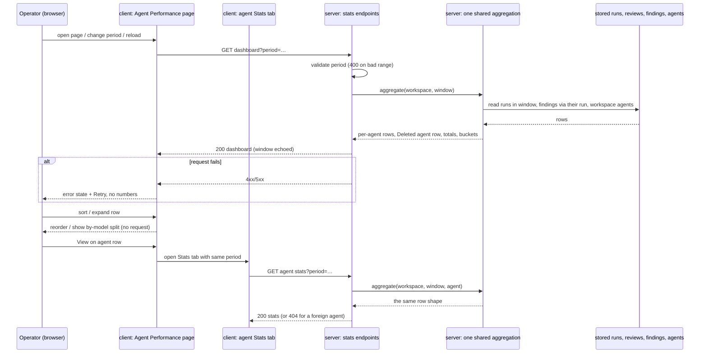
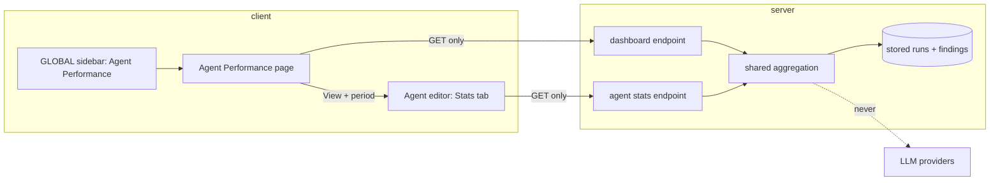

# Spec: Agent Performance dashboard and per-agent Stats
Spec ID: SPEC-2026-10-15-agent-performance
Status: approved
Tier: Full SDD — scorecard 5/6
Supersedes: none
Packages: server, client (e2e flow and dev seed as proof and demo data)
Design sources: screenshot `specs/designs/agent-performance/1.webp`, supplied with the brief on 2026-10-15. It shows the page title and subtitle, a "30 days" period button, and four summary cards: Total runs with a sparkline, Total cost with a previous-period delta, Avg accept rate with a ring, and Most-active agent. Below them are the agent table (Agent, Runs 30d, Avg cost, Avg dur., Accept with trend arrows, Last run, View) and a Cost breakdown with "By agent" and "By model" donuts. By the brief's instruction, the "-$1.20" delta, the accept-rate trend arrows and every sidebar item except "Agent Performance" under GLOBAL are ignored. The brief text (homework, translated) adds 1 day and custom range.

## Problem and user (L)(D)

The operator runs several review agents in one workspace and cannot tell which ones pay off. Run data is stored: status, model, duration and estimated cost for each run, and the accepted or dismissed decision on each finding. Nothing aggregates it. There is no per-agent Stats tab and no per-agent stats route, only an unused per-agent stats contract.

The operator wants one global screen that answers four questions for a chosen period:
- how many runs there were;
- what they cost;
- how often their findings are accepted;
- which agent does the most work.

The same numbers must also appear for one agent on its own Stats tab, and the two screens must never disagree.

## Outcome and metrics (D)

- Outcome: for any agent and period, the dashboard row and that agent's Stats tab show identical runs, cost, duration and accept rate, computed from stored data only.
- Metrics:
  - parity: 100% of agents match between the dashboard and Stats for the same period and instant (AC-20);
  - additivity: Σ by-agent cost = Σ by-model cost = Total cost (AC-17);
  - model calls caused by viewing either screen: 0 (AC-23, AC-40, AC-50).

## Goals / Non-goals (L)

Goals:
- A global **Agent Performance** page, reached from a new **GLOBAL** sidebar group.
- Period filter: 1 day, 30 days, and a custom range of whole UTC days.
- Summary cards: Total runs, Total cost, Avg accept rate, Most-active agent.
- An agent table (Agent, Runs, Avg cost, Avg duration, Accept rate, Last run, View) with sorting and an expandable by-model split per row.
- A cost breakdown by agent and by model, each summing exactly to Total cost.
- A minimal per-agent **Stats** tab in the agent editor that reads the same aggregation.
- Honest states: loading, error, an agent with no runs, a period with no runs at all.
- Clear cost provenance: every cost is a DevDigest estimate, and reconciled billing is shown as not connected.
- Deterministic demo data in the dev seed, written without any model call.

Non-goals:
- A previous-period comparison (the screenshot's "-$1.20") and accept-rate trend arrows.
- A runs-over-time sparkline on the Total runs card. The contract keeps its `trend` field filled, but no chart is drawn.
- Any other GLOBAL sidebar item from the screenshot (Memory, Multi-Agent Review, CI Runs).
- Importing or reconciling provider billing data. Reconciled cost is shown as "not connected" and never computed.
- Eval suite runs. Only review runs count.
- Changing how cost is estimated or attributed when a run completes (see Edge cases).
- Export, alerts, and per-repo or per-PR filtering on the dashboard.
- Any write from these screens: no accept/dismiss, no re-run, no review trigger.

## User stories

- As an operator, I open Agent Performance, pick "30 days" and see which agent has the best accept rate over enough decisions, so I know which agent to trust.
- As an operator, I see what the period cost and which models drove it, and I can tell that the figure is DevDigest's own estimate, not a bill.
- As an operator, I click View on one agent and land on its Stats tab with the same period and the same numbers.
- As an operator, I can tell "this agent didn't run in this period" apart from "nothing ran at all" and from "the page failed to load".

## Acceptance criteria (EARS) (L)

Proof tags: `red-first unit`, `red-first integration`, `e2e`, `browser (main session)`. The brief's "manual" maps to `browser (main session)`.

### Period and window (server)

- AC-1 WHEN a stats or dashboard request names the period `1 day`, the system shall count the runs whose run time is later than the request instant minus 24 hours and not later than the request instant. — proof: red-first integration — verify: pin the clock, seed runs at now−23h59m and now−24h01m, request 1 day, expect only the first counted.
- AC-2 WHEN a request names the period `30 days`, the system shall count the runs whose run time is later than the request instant minus 720 hours and not later than the request instant. — proof: red-first integration — verify: pin the clock, seed runs at now−719h and now−721h, expect only the first counted.
- AC-3 WHEN a request names a custom range with dates `from` and `to`, the system shall count the runs whose run time is at or after `from` 00:00:00 UTC and before the day after `to` 00:00:00 UTC. — proof: red-first integration — verify: seed runs at `from` 00:00:00Z, `to` 23:59:59Z and (`to`+1) 00:00:00Z, expect the first two counted.
- AC-4 IF a custom range is malformed, is missing `from` or `to`, has `from` after `to`, has `to` after today (UTC), or spans more than 366 days, THEN the system shall answer with a validation error (400) and return no aggregate. — proof: red-first integration — verify: send each of the five bad inputs to both endpoints, expect 400 with no metric fields in the body.
- AC-5 The system shall return, in every stats and dashboard response, the period kind and the resolved window as start and end instants. — proof: red-first integration — verify: request 30 days with a pinned clock, expect the window start at now−720h and the end at now.
- AC-6 WHEN the system counts finding decisions for a period, it shall attribute each finding to the agent and the run time of the run that produced its review, whenever the finding was accepted or dismissed, and shall leave out findings whose review is linked to no run. — proof: red-first integration — verify: a finding on a run 40 days old accepted today is absent from 30 days; a seeded review with no run link adds no decisions.

### Run inclusion, cost, duration (server)

- AC-7 The system shall count every run in the window toward Runs whatever its status (running, done, failed, cancelled), and shall return the count per status. — proof: red-first integration — verify: seed one run of each status for one agent, expect runs 4 and a per-status count of 1 each.
- AC-8 The system shall compute Avg duration over the done runs that have a recorded duration only. — proof: red-first integration — verify: done runs of 1,000 ms and 3,000 ms plus a failed run of 0 ms, expect 2,000 ms.
- AC-9 The system shall compute Avg cost as the summed cost of the done runs that have a recorded cost, divided by the number of those runs. — proof: red-first integration — verify: done runs costing $0.02 and $0.04 plus a done run with no cost, expect $0.03.
- AC-10 The system shall compute Total cost as the sum of every recorded cost among the counted runs, and shall report as unpriced the number of done runs that have no recorded cost. — proof: red-first integration — verify: costs $0.02 and $0.04 and one unpriced done run, expect total $0.06 and unpriced 1.
- AC-11 IF no counted run has a recorded cost, THEN the system shall return Total cost and Avg cost as null, never 0. — proof: red-first integration — verify: seed only unpriced and failed runs, expect a null total cost and a null avg cost.

### Accept rate (server)

- AC-12 The system shall compute an accept rate as accepted ÷ (accepted + dismissed), leave pending findings out, return the decision count (accepted + dismissed) beside it, and return null when the decision count is 0. — proof: red-first integration — verify: 3 accepted, 1 dismissed, 5 pending → rate 0.75 with 4 decisions; an agent with only pending findings → rate null, 0 decisions.
- AC-13 The system shall compute the headline Avg accept rate as Σaccepted ÷ Σdecisions across every row of the period, the Deleted agent row included, not as the mean of the per-agent rates. — proof: red-first integration — verify: agent A 9/10 accepted, agent B 0/2 → headline 0.75 (not 0.45).
- AC-14 The system shall flag a row, and the headline, as small sample when its decision count is below 10, zero included. — proof: red-first integration — verify: agents with 9 and 10 decisions, expect small sample true and false.

### Buckets and sums (server)

- AC-15 The system shall gather runs whose agent was deleted into one "Deleted agent" row that counts toward Total runs, Total cost, the headline accept rate and the by-agent breakdown, and that is never chosen as Most-active. — proof: red-first integration — verify: delete an agent with 3 runs, expect a row with no agent id, 3 runs, its cost in the totals, and Most-active naming a live agent.
- AC-16 The system shall gather runs that have no recorded model into one "Unknown model" bucket of the by-model breakdown. — proof: red-first integration — verify: seed a priced run with no model, expect an "Unknown model" bucket carrying its cost.
- AC-17 The system shall return by-agent and by-model breakdowns whose costs each sum to Total cost within 1e-9 USD, and whose run counts each sum to Total runs. — proof: red-first integration — verify: seed 3 agents × 2 models plus a deleted-agent run and a no-model run, assert both sums against the totals.

### Most-active (server)

- AC-18 The system shall name as Most-active the existing agent with the most runs in the window, break ties by the latest last run and then by agent name A→Z, and return none when no existing agent ran. — proof: red-first integration — verify: two agents with 5 runs each where B ran last → B; equal last run → the name first alphabetically; only deleted-agent runs → none.

### Rows, parity, scoping, no model calls (server)

- AC-19 The system shall return one row for every agent of the workspace, disabled agents included, even when the agent has no runs in the window. — proof: red-first integration — verify: three agents, one with no runs and one disabled, expect three rows, the idle one with runs 0 and null averages.
- AC-20 WHEN the dashboard and an agent's Stats are requested for the same period at the same instant, the system shall return for that agent identical values for:
  - runs and per-status counts;
  - Total cost, Avg cost and the unpriced count;
  - Avg duration;
  - accepted, dismissed, pending, accept rate and the small-sample flag;
  - last run;
  - the split by model.

  — proof: red-first integration — verify: pin the clock and seed several agents with mixed statuses, costs and decisions. For each period kind and every agent, deep-compare the dashboard row with the Stats response for that agent.
- AC-21 IF the agent named in a Stats request does not exist in the caller's workspace, THEN the system shall answer 404 and return no aggregate. — proof: red-first integration — verify: request Stats for an agent of another workspace and for a random id, expect 404 for both.
- AC-22 The system shall aggregate only the caller's workspace: no run, agent or finding of another workspace may affect any number or row. — proof: red-first integration — verify: seed a second workspace with runs and decisions, expect the first workspace's dashboard unchanged.
- AC-23 WHEN the dashboard or Stats endpoint answers, the system shall make no LLM provider call and write no row. — proof: red-first integration — verify: with a counting mock provider registered under every provider id, call both endpoints for all period kinds, expect 0 provider calls and unchanged row counts for runs, reviews and findings.

### Dashboard page (client)

- AC-24 The system shall show a GLOBAL sidebar group with one item, "Agent Performance", that opens the Agent Performance page and is marked active while that page is open. — proof: red-first unit — verify: render the shell on the Agent Performance route, expect a link named "Agent Performance" under GLOBAL in the active state.
- AC-25 WHEN the Agent Performance page opens without a period in its address, the system shall select 30 days and offer the choices 1 day, 30 days and Custom range. — proof: red-first unit — verify: render the page with no period, expect 30 days selected and three choices.
- AC-47 WHEN the user picks a period, the system shall keep it in the page address so that a reload shows the same period. — proof: red-first unit — verify: choose 1 day, expect the address to carry it; re-render from that address, expect 1 day selected.
- AC-26 WHEN Custom range is chosen, the system shall let the user pick a from and a to date (UTC), and shall not request data until both are set and valid. — proof: red-first unit — verify: pick only `from`, expect no stats request; pick `to`, expect one request with both dates.
- AC-27 WHEN data has loaded, the system shall show four cards, each naming the selected period:
  - Total runs, with the per-status counts that are non-zero (e.g. "incl. 2 failed");
  - Total cost, with the unpriced-run count;
  - Avg accept rate, with "n decisions", a note that it pools decisions across agents, and a small-sample badge when it applies;
  - Most-active agent, with name, runs, and accept rate with its decisions.

  — proof: red-first unit — verify: render with a fixture of known totals, expect each value, "incl. 2 failed", "1 unpriced run", "12 decisions" and the pooled note.
- AC-46 The system shall state on the page that Runs counts every run in the period (running, done, failed, cancelled) and that Avg cost, Avg duration and the unpriced count cover completed runs only. — proof: red-first unit — verify: render the page with data, expect the note text near the table header.
- AC-28 The system shall label every cost figure on the page as "DevDigest estimate (token × price book)" and show "Reconciled billing: not connected" on the Total cost card, with no reconciled amount anywhere. — proof: red-first unit — verify: render with costs, expect the estimate label on the Total cost card, the table's cost column and the breakdown, plus the "not connected" line; expect no dollar figure labelled reconciled.
- AC-29 The system shall show a table with the columns Agent, Runs, Avg cost, Avg duration, Accept rate (with "n decisions" and a "small sample" badge below 10), Last run and View. — proof: red-first unit — verify: render a fixture with one 9-decision agent, expect the seven column headers and the badge on that row only.
- AC-30 WHILE no column has been chosen, the system shall sort rows by accept rate, highest first, in this order:
  1. agents with 10 or more decisions;
  2. small-sample agents with 1 to 9 decisions;
  3. agents with no decisions;
  4. the Deleted agent row, always last.

  Ties break by runs (most first), then by name A→Z. — proof: red-first unit — verify: a fixture with a 20-decision agent at 50%, a 3-decision agent at 100%, a 0-decision agent and a Deleted agent row; expect that order.
- AC-31 WHEN the user sorts by a column (Agent, Runs, Avg cost, Avg duration, Accept rate, Last run), the system shall reorder the rows without any request. Empty values go last in either direction. Sorting by accept rate keeps the small-sample grouping, and the Deleted agent row stays last. — proof: red-first unit — verify: click each header twice, expect the order and zero new fetch calls.
- AC-32 WHEN an agent has no runs in the period, the system shall show its row with "No runs in this period" and "—" for every average, rate and last run. — proof: red-first unit — verify: a fixture row with runs 0, expect the text and "—" cells.
- AC-33 The system shall render every null metric as "—" and never as 0, $0.00 or 0%. — proof: red-first unit — verify: a fixture with null total cost, null avg duration and null accept rate, expect "—" in each place and no "$0.00" or "0%".
- AC-34 WHILE the data for the selected period is loading, the system shall show placeholders in place of every card, row and breakdown, and no number. — proof: red-first unit — verify: hold the request pending, expect skeletons and no digit in the cards, table or breakdown.
- AC-35 IF the dashboard request fails, THEN the system shall show an error state with a retry action and no number. — proof: red-first unit — verify: answer 500, expect the error text, a Retry button and no card values; Retry issues one new GET.
- AC-36 WHEN no run of the workspace falls in the selected period, the system shall show a page-level empty state ("No agent runs in this period") with the period selector still usable, and no cards, table numbers or breakdowns. — proof: red-first unit — verify: a fixture with zero total runs and two agents, expect the empty state and no "0" card values.
- AC-37 The system shall show a Cost breakdown with a By agent list and a By model list (by run model). Each list names every bucket that has runs, with its cost ("—" when unpriced), including the Deleted agent and Unknown model buckets when present. — proof: red-first unit — verify: a fixture with both special buckets, expect them listed with their costs.
- AC-38 WHEN the user expands an agent row, the system shall show that agent's split by model (runs, cost, accept rate with decisions) from the data already loaded, without a new request. — proof: red-first unit — verify: expand a row, expect the model lines and zero new fetch calls.
- AC-39 WHEN the user clicks View on an agent row, the system shall open that agent's Stats tab with the same period (the preset, or the same from and to dates). — proof: red-first unit — verify: with Custom range 2026-10-01..2026-10-07, click View, expect navigation to the agent's Stats tab carrying both dates.
- AC-40 WHEN the dashboard or a Stats tab loads, reloads, changes period, sorts or expands a row, the browser shall send only GET requests to the stats, dashboard and agent endpoints, and no review-run request. — proof: browser (main session) — verify: open the page with the network panel, do each action, expect only those GETs and an unchanged run count in the dev database.

### Stats tab (client)

- AC-41 WHEN the agent editor opens with the Stats tab named in its address, the system shall show the Stats tab with the period named in the address (30 days when none). — proof: red-first unit — verify: a page-level test opening the agent page with the Stats tab and a 1-day period, expect the Stats tab active and 1 day selected; an unknown tab still falls back to Config.
- AC-42 The system shall show on the Stats tab:
  - the same metrics as the agent's dashboard row: runs with per-status counts, Total cost with the unpriced count and the estimate label, Avg cost, Avg duration, accept rate with decisions and the small-sample badge, pending count, last run;
  - its split by model;
  - the same period selector.

  — proof: red-first unit — verify: render the tab with a fixture, expect each metric, the model lines and the three period choices.
- AC-48 The system shall show on the Stats tab the no-runs, null, loading and error states of AC-32 to AC-35. — proof: red-first unit — verify: with runs 0 expect "No runs in this period"; with a pending request expect no digits; with a failed request expect the error state with Retry.

### Demo data and end-to-end

- AC-43 WHEN the dev seed runs, the system shall store review runs, placed relative to the seed time, on a seeded PR of their own. They shall cover at least two agents and two models within the last 24 hours and within the last 30 days, and include:
  - one agent with 10 or more decisions;
  - one agent with 1 to 9 decisions;
  - one agent with no runs;
  - a failed run;
  - a done run with no recorded cost;
  - a run with no agent;
  - a run with no model.

  Every seeded finding shall belong to a review linked to a seeded run. — proof: red-first integration — verify: seed a fresh database, query the aggregation for 1 day and 30 days, expect each case present.
- AC-49 WHEN the dev seed runs a second time, the system shall leave the number of seeded runs, reviews and findings unchanged, and shall move the seed-owned demo runs to the new seed time. — proof: red-first integration — verify: seed twice, compare counts; the newest demo run is within the last 24 hours after the second seed.
- AC-50 WHEN the dev seed runs, the system shall make no LLM provider call. — proof: red-first integration — verify: a counting mock under every provider id, run the seed, expect 0 calls.
- AC-51 WHEN the demo data is seeded, the system shall leave the existing seeded screens unchanged: PR #482's latest review, its findings and its PR-list cost. — proof: e2e — verify: the existing hermetic flows pass unchanged on the new seed.
- AC-44 WHEN the user opens Agent Performance from the sidebar on seeded data, the system shall show the seeded agents and support this journey: switch to 1 day with different totals, expand a row, and open View on the Stats tab with the same runs and accept rate as the row. — proof: e2e — verify: hermetic flow. Click "Agent Performance", wait for a seeded agent name, assert the Total runs value. Choose "1 day" and assert the new value. Expand a row, click View, and assert the same runs and accept-rate text on the Stats tab.
- AC-45 WHEN the workspace holds 10,000 runs and 50,000 findings within the window, the system shall answer the dashboard request within 1 s on a local development machine. — proof: browser (main session) — verify: load the synthetic volume into a dev database and time the dashboard request three times; expect each under 1 s.

## Edge cases (L)

Existing behaviour that shapes the numbers (this spec does not change it):
- The first agent of a review batch also carries that batch's intent-extraction cost. That cost lands in that agent's row and under that run's model in the by-model breakdown, even when intent used another model. The breakdown says "by run model".
- A failed run has no recorded cost, and a pre-work failure records a duration of 0. That is why the averages read done runs only (AC-8, AC-9, AC-46).
- Runs left running when the API restarts are marked failed at boot. They count as failed.
- Accepting a finding clears its dismissal and the reverse, so a finding is never counted as both.
- Runs from CI count like local runs. No CI ingestion exists today.

Other cases:
- **Rolling windows and parity.** View carries the preset, not frozen instants, so the Stats tab re-resolves "now". A run that lands between the two requests can shift a number by one run. The echoed window (AC-5) shows each screen's bounds. Parity is tested at one pinned instant (AC-20).
- **A run still running** counts toward Runs and Last run, but not toward the averages until it completes.
- **Rounding.** Server values are unrounded, and cents apply only for display. Rounded bucket figures can differ from the rounded total by up to $0.01 per bucket. The breakdown shows a footnote when the rounded sum differs from the rounded total.
- **Very small costs** below $0.01 must not display as $0.00: the page reuses the existing cost formatter of the PR list and run timeline.
- **Agent renamed** mid-period: the row shows the current name.
- **Agent deleted**: its runs move to the Deleted agent row, and its findings follow their run.
- **Agent model changed** mid-period: the by-model split uses each run's stored model, so one agent can span several models.
- **Same model string from different providers**: grouped by the model string only.
- **Long agent or model names** truncate, with the full name available on hover or focus.
- **Many agents** (50+): every row renders, with no pagination in this version.
- **Two tabs** on different periods are independent, because the period lives in each tab's address.
- **Custom range with today as `to`**: the window ends at tomorrow 00:00 UTC, so it holds every run so far.
- **Only deleted-agent runs in the period**: the cards show totals, Most-active shows "—" with "No current agent ran", and every live agent row shows "No runs in this period".
- **Agents exist but none ran in the period**: the page-level empty state of AC-36.

## Non-functional requirements (L)

- Performance: the dashboard and Stats answer within 1 s for 10,000 runs and 50,000 findings in the window (AC-45). Each request is one aggregation pass, with no per-agent round trips from the browser.
- Cost: no new LLM calls, 0 tokens (AC-23, AC-40, AC-50).
- Security and privacy:
  - every query is scoped to the caller's workspace (AC-22);
  - a foreign or unknown agent id answers 404 (AC-21), which closes the IDOR path;
  - period and date parameters are validated against an allow-list and the 366-day cap before any query (AC-4);
  - error bodies carry a fixed message, never raw database text;
  - agent and model names render as text only, never as HTML or links.
- Accessibility:
  - sortable headers are buttons that expose the current sort direction;
  - the small-sample badge and the accept-rate colours carry text, not colour alone;
  - the expand control states whether the row is open;
  - the period selector and date inputs work by keyboard;
  - breakdown charts keep a text list of every bucket with its value.
- i18n: every new user-facing string goes through the app's message catalogue. The page uses the existing Agent Performance namespace, rewritten to match this spec, and the Stats tab uses the agents namespace. Custom-range dates display in UTC, and Last run shows relative time ("4m ago").
- Reliability: the endpoints are idempotent reads. A failed request shows the error state (AC-35), and retry re-issues one GET; there is no automatic retry loop. A database timeout returns an error, never partial numbers.

## Workflows and module communication

## Contracts

Both responses are additions to the shared observability contract:
- The server copy is canonical, and the client copy is mirrored byte-for-byte in the same change. Diff only the touched file, because the two copies already drift in comments elsewhere.
- The existing `AgentStats` is extended additively and becomes the one row shape that both endpoints return, so parity is an object comparison. Nothing reads `AgentStats` today.
- JSON is snake_case.

**Period parameters** (both endpoints, query string): `period` = `1d` | `30d` | `custom`, plus `from` and `to` (`YYYY-MM-DD`) when `custom`. A missing `period` means `30d`.

**`GET /agents/:id/stats`** → `AgentStats` (extended), or 404 when the agent is not in the caller's workspace.

**`GET /agent-performance`** → `AgentPerformance`. The name is chosen so it cannot collide with `/agents/:id`.

`AgentStats` keeps its existing fields, with these meanings under a period:

| field | meaning |
|---|---|
| `agent_id`, `agent_name` | the agent (current name) |
| `runs` | all runs in the window, any status |
| `findings_total` | findings of reviews linked to those runs |
| `accepted`, `dismissed`, `pending` | decision counts over those findings |
| `accept_rate` | accepted ÷ (accepted + dismissed), null at 0 decisions |
| `dismiss_rate` | dismissed ÷ (accepted + dismissed), null at 0 decisions |
| `avg_findings_per_run` | findings_total ÷ done runs, null at 0 done runs |
| `total_cost_usd` | sum of recorded costs, null when none |
| `avg_cost_usd` | as AC-9, null when no priced done run |
| `avg_latency_ms` | **Avg duration** as AC-8, null when no done run has a duration |
| `findings_by_severity` | counts of those findings per severity |
| `trend` | runs per UTC day in the window, oldest → newest (not drawn in this version) |

It gains these fields:

| field | meaning |
|---|---|
| `window` | `{ period: '1d' \| '30d' \| 'custom', start, end }`, instants in ISO 8601 UTC |
| `runs_by_status` | `{ running, done, failed, cancelled }` |
| `unpriced_runs` | done runs with no recorded cost |
| `decisions` | accepted + dismissed |
| `small_sample` | decisions < 10 |
| `last_run_at` | latest run time in the window, null when none |
| `by_model` | `[{ model: string \| null, runs, total_cost_usd \| null, accepted, dismissed, decisions, accept_rate \| null }]` |
| `cost_basis` | always `'estimate'` |

`AgentPerformance`:

| field | meaning |
|---|---|
| `window` | as above |
| `small_sample_threshold` | 10 |
| `cost_basis` | `'estimate'` |
| `billing_reconciliation` | `'not_connected'` |
| `totals` | `{ runs, runs_by_status, total_cost_usd \| null, unpriced_runs, accepted, dismissed, pending, decisions, accept_rate \| null, small_sample }` |
| `most_active` | `{ agent_id, agent_name, runs, accept_rate \| null, decisions }` or null |
| `agents` | `AgentStats[]`, one per workspace agent |
| `deleted_agents` | the `AgentStats` metric fields without an agent id or name (label "Deleted agent"), or null when no such run is in the window |
| `cost_by_agent` | `[{ agent_id \| null, agent_name \| null, runs, total_cost_usd \| null }]` |
| `cost_by_model` | `[{ model \| null, runs, total_cost_usd \| null }]` |

## Inputs and provenance (L)

- Runs in the window: status, model, duration, cost, run time, agent [deterministic: stored review runs]
- Per-run cost [reused: run cost estimated at run completion from tokens × price book]
- Finding decisions: accepted / dismissed / pending, severity [deterministic: stored findings, linked through their review's run]
- Workspace agents: id, name, enabled [deterministic: stored agents]
- Request instant and period [deterministic: server clock + validated query]
- Demo data [deterministic: dev seed, no model call]
- No input is [new: LLM call].

## Untrusted inputs (L)

- **Query parameters** (`period`, `from`, `to`, the agent id): controllable by whoever sends the request. They are validated against the allow-list, the date format, the order, the not-in-the-future rule and the 366-day cap before any query, and are never spliced into query text. A bad value answers 400 with a fixed message.
- **Agent names** (entered by the operator) and **model strings** (supplied by a provider or the operator): rendered as plain text, never as HTML, Markdown or a link.
- **Finding content** is not displayed by these screens. Only decision counts and severities are read.
- **Screenshot `1.webp`**: design data only. No text in it addressed the agent.

## Open questions (L)(D)

All resolved by Glib on 2026-10-15 (recommended defaults accepted):
- Custom-range cap: 366 days (AC-4).
- Performance bound: 10,000 runs / 50,000 findings / 1 s (AC-45).
- Demo seed timing: relative to seed time; a re-seed moves only the seed-owned demo runs, same row count (AC-43, AC-49).
- Sub-cent display: reuse the existing cost formatter (Edge cases).
- Runs sparkline: out of scope; `trend` stays filled (Non-goals).
- Averages: Runs counts every status; Avg cost, Avg duration and the unpriced count use done runs only (AC-8, AC-9, AC-46).

## Traceability (L)

| AC | proof | verify | step | test | commit |
|---|---|---|---|---|---|
| AC-1 | red-first integration | pinned clock; runs at now−23h59m / now−24h01m; 1 day counts the first only | — | — | — |
| AC-2 | red-first integration | runs at now−719h / now−721h; 30 days counts the first only | — | — | — |
| AC-3 | red-first integration | runs at from 00:00Z, to 23:59:59Z, to+1 00:00Z; first two counted | — | — | — |
| AC-4 | red-first integration | five bad custom inputs on both endpoints → 400, no metrics | — | — | — |
| AC-5 | red-first integration | 30 days with a pinned clock echoes start = now−720h, end = now | — | — | — |
| AC-6 | red-first integration | 40-day-old run's finding accepted today absent from 30 days; review without a run adds nothing | — | — | — |
| AC-7 | red-first integration | one run per status → runs 4, per-status 1 each | — | — | — |
| AC-8 | red-first integration | done 1,000 / 3,000 ms + failed 0 ms → 2,000 ms | — | — | — |
| AC-9 | red-first integration | done $0.02 / $0.04 + unpriced done → $0.03 | — | — | — |
| AC-10 | red-first integration | $0.02 + $0.04 + unpriced → total $0.06, unpriced 1 | — | — | — |
| AC-11 | red-first integration | only unpriced/failed runs → total and avg cost null | — | — | — |
| AC-12 | red-first integration | 3 acc / 1 dis / 5 pending → 0.75, 4 decisions; only pending → null, 0 | — | — | — |
| AC-13 | red-first integration | A 9/10, B 0/2 → headline 0.75 | — | — | — |
| AC-14 | red-first integration | 9 vs 10 decisions → small sample true / false | — | — | — |
| AC-15 | red-first integration | deleted agent with 3 runs → Deleted agent row, in totals, never Most-active | — | — | — |
| AC-16 | red-first integration | priced run with no model → Unknown model bucket | — | — | — |
| AC-17 | red-first integration | 3 agents × 2 models + deleted + no model: both breakdowns sum to the totals | — | — | — |
| AC-18 | red-first integration | tie on runs → latest last run, then name; only deleted runs → none | — | — | — |
| AC-19 | red-first integration | 3 agents incl. idle and disabled → 3 rows, idle row has nulls | — | — | — |
| AC-20 | red-first integration | pinned clock, every agent × every period kind: dashboard row deep-equals Stats | — | — | — |
| AC-21 | red-first integration | foreign and random agent id → 404 | — | — | — |
| AC-22 | red-first integration | a second workspace's data never changes the first workspace's dashboard | — | — | — |
| AC-23 | red-first integration | counting mock under every provider id → 0 calls, row counts unchanged | — | — | — |
| AC-24 | red-first unit | shell on the page route shows GLOBAL → Agent Performance, active | — | — | — |
| AC-25 | red-first unit | no period → 30 days selected, three choices | — | — | — |
| AC-26 | red-first unit | only `from` → no request; both → one request | — | — | — |
| AC-27 | red-first unit | fixture → card values, "incl. 2 failed", unpriced, decisions, pooled note | — | — | — |
| AC-28 | red-first unit | estimate label on every cost surface; "not connected" line; no reconciled figure | — | — | — |
| AC-29 | red-first unit | seven headers; small-sample badge on the 9-decision row only | — | — | — |
| AC-30 | red-first unit | 20-dec 50%, 3-dec 100%, 0-dec, Deleted → that order | — | — | — |
| AC-31 | red-first unit | each header twice → expected order, 0 new fetches | — | — | — |
| AC-32 | red-first unit | runs 0 row → "No runs in this period" and "—" | — | — | — |
| AC-33 | red-first unit | null metrics → "—", no "$0.00" or "0%" | — | — | — |
| AC-34 | red-first unit | pending request → skeletons, no digits | — | — | — |
| AC-35 | red-first unit | 500 → error + Retry, no values; Retry = one GET | — | — | — |
| AC-36 | red-first unit | zero total runs → page empty state, no "0" cards | — | — | — |
| AC-37 | red-first unit | breakdown lists Deleted agent and Unknown model with their costs | — | — | — |
| AC-38 | red-first unit | expand → model lines, 0 new fetches | — | — | — |
| AC-39 | red-first unit | custom 2026-10-01..07 → View opens Stats with both dates | — | — | — |
| AC-40 | browser (main session) | network panel: only GETs to stats/dashboard/agents; run count unchanged | — | — | — |
| AC-41 | red-first unit | page-level: Stats tab + 1 day in the address → Stats tab, 1 day; unknown tab → Config | — | — | — |
| AC-42 | red-first unit | Stats tab fixture: every metric, model lines, three period choices | — | — | — |
| AC-43 | red-first integration | fresh seed: every demo case present for 1 day and 30 days, on its own PR | — | — | — |
| AC-44 | e2e | sidebar → seeded agents → 1 day changes totals → expand → View shows the same runs and rate | — | — | — |
| AC-45 | browser (main session) | 10k runs / 50k findings → dashboard under 1 s, three timings | — | — | — |
| AC-46 | red-first unit | the page shows the run-inclusion and done-only averages note | — | — | — |
| AC-47 | red-first unit | choosing 1 day writes it to the address; re-render keeps it | — | — | — |
| AC-48 | red-first unit | Stats tab: runs 0, pending, failed request → the matching states | — | — | — |
| AC-49 | red-first integration | seed twice → identical counts, newest demo run within 24 h | — | — | — |
| AC-50 | red-first integration | seed with a counting mock → 0 provider calls | — | — | — |
| AC-51 | e2e | existing hermetic flows pass unchanged on the new seed | — | — | — |

## Changelog (L)(D)

| date | change | why |
|---|---|---|
| 2026-10-15 | Spec created (create mode, Full SDD, draft). | Homework brief: Agent Performance dashboard plus per-agent Stats sharing one aggregation; the brief's settled decisions recorded as ACs. |
| 2026-10-15 | Approved; the five open questions resolved with the recommended defaults; AC-49 also checks that re-seeding moves demo runs to the new seed time. | Glib accepted all recommended defaults, including done-only averages. |
